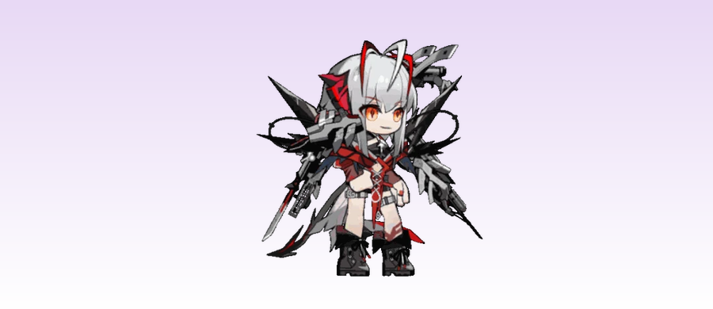

# 维什戴尔 桌面小人 (Wishadel Desktop Pet)

macOS 桌面宠物 —— 维什戴尔（Wishadel）。

## 预览

## 下载安装

1. 打开本仓库的 **Releases** 页面
2. 下载最新版 `Wishadel-2.0.0-arm64-mac.zip`
3. 解压后把 `维什戴尔.app` 拖入"应用程序"（/Applications）
4. 双击启动（如系统提示"无法验证开发者"，右键点击 app → 打开 → 再点一次"打开"）

## 功能

- 🎭 三套皮肤：默认 / 绝对主角 / 超新星（右键 → 皮肤）
- 🚶 自动待机、行走、坐下、睡觉（每 2 分钟睡 10 秒）
- 🖱️ 点击触发交互动画（交互1 75% / 交互2 25%，完整播放）
- 🛋️ 碰到长椅自动坐下（两端位置、50% 概率、坐下 15-45 秒）
- 📌 悬浮置顶、单实例、跨桌面显示
- ⚡ 默认 30x 播放速度，交互 1.5 倍速，右键可调 0.5x-30x
- 🖥️ 右键菜单跟随小人侧边弹出，支持滚轮滑动

## 版本

- v2.0.0 (2026-10-29)
